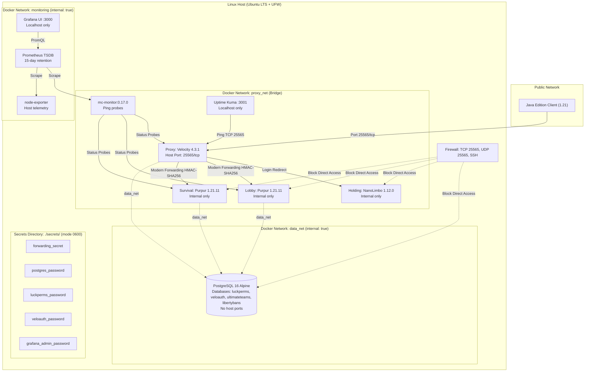

# Minecraft Network Specification (PROJECT.md)

> **The primary architectural specification and Single Source of Truth for the Minecraft Network infrastructure.**  
> Every technical standard, container configuration, security policy, and operational procedure documented here governs the codebase.
> 
> *Detailed procedural and technical specifications reside under [`docs/`](docs/).*

---

## 1. Vision & Architecture Principles

### 1.1 Purpose & Scale
**Minecraft Network** is an automated, containerized server infrastructure featuring a **Velocity** ingress gateway, lightweight **NanoLimbo** holding pen, centralized **Lobby**, and an enhanced **Survival SMP (Purpur 1.21.x)** backend.

- **Target Capacity:** 20–50 concurrent players (CCU) with strictly budgeted memory limits.
- **Gameplay Philosophy (Vanilla+ Enhanced SMP):** Preserves core vanilla sandbox survival without intrusive land claims (protected via **CoreProtect** inspection and fast rollbacks) and barter economy, enriched with:
  - **Procedural 3-Dimension World Generation:** 
    - **Overworld:** Procedural engine **TerraformGenerator** (ADR 0016) + **Structory**, **Structory: Towers**, **Dungeons & Taverns**, and **BetterStructures**.
    - **Nether:** Monumental volcanic terrain and Sanctum castles via **Incendium**.
    - **The End:** Void landscapes and floating islands reaching Y=384 via **Nullscape**.
    - **100% Server-Side (Zero Client Mods):** Datapacks run entirely on the server; clients connect with vanilla Minecraft 1.21.
  - **Administrative & Anti-Cheat Suite:** **GrimAC**, **Anti-AutoTotem**, **Raycasted Anti-ESP**, **LibertyBans**, **InvSee++**, and **InventoryRollbackPlus**.
  - **RPG Progression:** **EcoSkills**, **EcoEnchants**, and **EcoItems** running on the Auxilor `libreforge` engine.
  - **Quality of Life:** **GSit** (poses & crawling), **BetterSleeping** (20% sleep threshold), **InteractiveChat** (`[item]`, `[inv]`, `[ender]`), and **Simple Voice Chat** (proximity voice).

### 1.2 Identity & Strict Mixed-Mode Authentication
- **Mojang Premium Accounts:** Direct cryptographic session verification with Mojang. Automatic login with official UUIDs and skins.
- **Non-Premium Accounts:** Quarantined in NanoLimbo; VeloAuth enforces BCrypt registration/login.
- **Anti-Impersonation (`allow-cracked-on-premium-nicks: false`):** Non-Premium clients cannot claim or join under nicknames registered in Mojang's official database.

---

## 2. Infrastructure & Topology

### 2.1 Network Topology Diagram

### 2.2 Container Resource Inventory

| Container | Base Image | Role | JVM Memory (Xmx) | Docker Memory Limit | Network Scope |
|---|---|---|---|---|---|
| `proxy` | `itzg/mc-proxy:java25` | Ingress Gateway, Velocity, VeloAuth | 512 MB | 768 MB | `0.0.0.0:25565:25565/tcp` |
| `auth` | `eclipse-temurin:21-jre` | NanoLimbo Holding Buffer | 256 MB | 384 MB | Internal `proxy_net` |
| `lobby` | `itzg/minecraft-server:java25` | Transit Hub & Navigation | 1024 MB | 1.5 GB | `proxy_net` + `data_net` |
| `survival` | `itzg/minecraft-server:java25` | Main SMP Backend | 4096 MB | 5.5 GB | `proxy_net` + `data_net` |
| `postgres` | `postgres:16.4-alpine` | Relational Storage | N/A | 512 MB | Internal `data_net` |
| `uptime-kuma` | `louislam/uptime-kuma:1.23.16` | Availability Monitoring & Alerts | N/A | 256 MB | `127.0.0.1:3001` |
| `prometheus` | `prom/prometheus:v2.55.1` | Time-series Metrics TSDB | N/A | 512 MB | Internal `monitoring` |
| `node-exporter`| `prom/node-exporter:v1.8.2` | Host Linux Resource Telemetry | N/A | 128 MB | Internal `monitoring` |
| `minecraft-exporter` | `itzg/mc-monitor:0.17.0` | Game Server Ping Metrics | N/A | 128 MB | `proxy_net` + `monitoring` |
| `grafana` | `grafana/grafana:11.2.0` | Analytics Dashboards | N/A | 384 MB | `127.0.0.1:3000` |

---

## 3. Data Layer & Zero-Redis Architecture

- **PostgreSQL 16 Alpine Consolidation:** All databases (`luckperms`, `veloauth`, `ultimateteams`, `libertybans`) run in dedicated schemas with least-privilege user isolation.
- **Zero Redis Policy (ADR 0012):** Redis is permanently eliminated. Permission synchronization uses native `pluginmsg` channels, and skin caching runs in-memory, saving RAM and operational complexity.
- **Declarative Permissions Seeding:** LuckPerms is automatically initialized on startup via `infrastructure/postgres/seed-luckperms.sql`, defining the 7-tier rank model:
  1. `default` (weight 10)
  2. `vip` (weight 20)
  3. `svip` (weight 30)
  4. `helper` (weight 40)
  5. `moderator` (weight 60)
  6. `administrator` (weight 80)
  7. `owner` (weight 100)
  Tracks: `staff` and `donor`.

---

## 4. Theming and Localization Engine

- **Semantic Color Tokens:** Managed centrally via `configs/network.yml`. Supported presets include `amber-sunset`, `cyber-blue`, `emerald-forest`, and `amethyst-purple`.
- **Localization Bundles:** Stored in `locales/en.yml` and `locales/pl.yml`. The template compiler seamlessly injects translated messages and theme tokens into runtime configurations during `./bin/network install`.

---

## 5. Declarative Supply Chain & Backups

- **Plugins & Datapacks:** Managed declaratively via `configs/plugins/manifest.yml` and `components.yml`. Download URLs and SHA-512 / SHA-256 digests are pinned in `lock.yml` and `components.lock.yml`.
- **Cryptographic Backups:** Backups are compressed, dumped from PostgreSQL, and encrypted with asymmetric `age` recipient keys. Identity keys remain strictly offsite.
