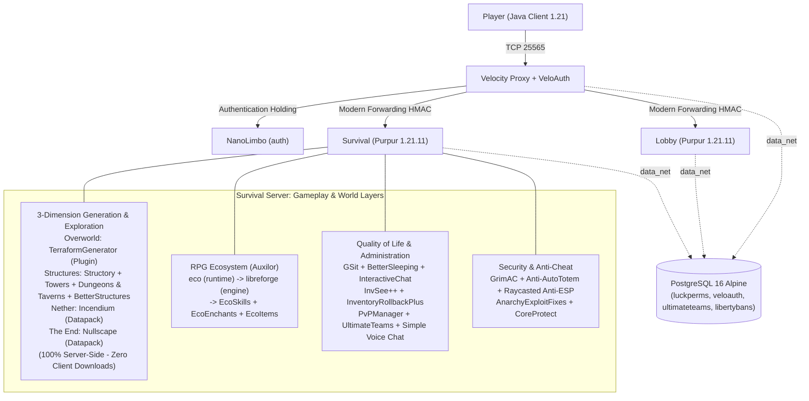

# Minecraft Network Architecture

```text
Internet
   |
TCP 25565
   v
[Velocity + VeloAuth] -- proxy_net --> [NanoLimbo auth]
       |                                [Lobby]
       |                                [Survival (Purpur 1.21.11)]
       |                                    |
       +----------- data_net (internal) ----+
                         |
                 [PostgreSQL 16] (luckperms, veloauth, ultimateteams, libertybans)

Monitoring profile (optional, internal):
[mc-monitor + node-exporter] --> [Prometheus] --> [Grafana (127.0.0.1:3000)]
[Uptime Kuma (127.0.0.1:3001)] --> proxy probes
```



Velocity is the sole public network ingress point (TCP 25565). Backend game servers (`auth`, `lobby`, `survival`) and PostgreSQL publish zero host ports, adhering strictly to Zero-Trust and Port Isolation principles.

---

## 1. Traffic Routing & Authentication Flow

- **Official Premium Accounts:** Connection handshakes directly with Mojang session servers via VeloAuth. Players authenticate transparently with official skins and UUIDs without entering passwords.
- **Non-Premium Accounts:** Players are quarantined into `NanoLimbo` (The End dimension with zero tick CPU overhead) where VeloAuth enforces BCrypt registration/login. Credentials reside in the isolated `veloauth` PostgreSQL database.
- **Internal Network Security:** All backend connections require Modern Velocity Forwarding signed by HMAC-SHA256 tokens (`secrets/forwarding_secret`). Direct connection attempts bypass the proxy and are rejected.

---

## 2. Component Inventory

| Service | Runtime / Base Image | System Role | JVM Memory (Xmx) | Docker Memory Limit | Network Scope |
|---|---|---|---|---|---|
| `proxy` | `itzg/mc-proxy:java25` | Ingress Gateway, Velocity, VeloAuth | 512 MB | 768 MB | `0.0.0.0:25565/tcp` |
| `auth` | `eclipse-temurin:21-jre` | NanoLimbo Authentication Holding Buffer | 256 MB | 384 MB | Internal `proxy_net` only |
| `lobby` | `itzg/minecraft-server:java25` | Transit Hub, Navigation GUI, NPC Guide | 1024 MB | 1.5 GB | `proxy_net` + `data_net` |
| `survival` | `itzg/minecraft-server:java25` | Main SMP, Auxilor RPG, 3-Dimension Worldgen | 4096 MB | 5.5 GB | `proxy_net` + `data_net` |
| `postgres` | `postgres:16.4-alpine` | Consolidated relational storage | N/A | 512 MB | Internal `data_net` only |
| `uptime-kuma` | `louislam/uptime-kuma:1.23.16` | Status page & availability probing | N/A | 256 MB | `127.0.0.1:3001` |
| `prometheus` | `prom/prometheus:v2.55.1` | Time-series metrics TSDB | N/A | 512 MB | Internal `monitoring` only |
| `node-exporter` | `prom/node-exporter:v1.8.2` | Host Linux resource telemetry | N/A | 128 MB | Internal `monitoring` only |
| `minecraft-exporter` | `itzg/mc-monitor:0.17.0` | Game server latency & player ping metrics | N/A | 128 MB | `proxy_net` + `monitoring` |
| `grafana` | `grafana/grafana:11.2.0` | Analytics dashboards | N/A | 384 MB | `127.0.0.1:3000` |

---

## 3. Hardware Resource Budget

- **Recommended Host:** 4 vCPU, 12–16 GB RAM, 100+ GB NVMe SSD.
- Total memory ceiling for active services (including monitoring stack) is ~10.0 GB, leaving ~6.0 GB for OS buffers, disk caching, and preventing Linux OOM invocation.
