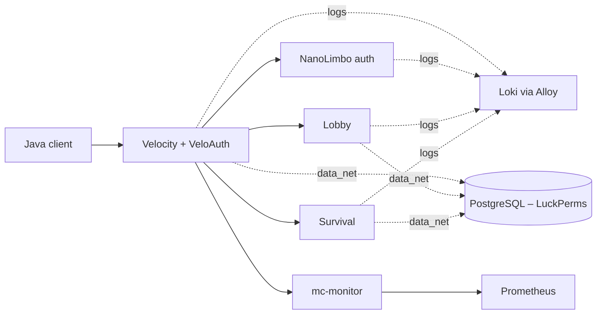

# Architektura

```text
Internet
   |
TCP 25565
   v
[Velocity + VeloAuth] -- proxy_net --> [NanoLimbo auth]
       |                                [Lobby]
       |                                [Survival]
       |                                    |
       +----------- data_net (internal) ----+
                         |
                 [PostgreSQL]     [Redis profile: cache]

[Prometheus] --> [Grafana]
[Alloy + Docker socket] --> [Loki]
[node-exporter + cAdvisor] --> [Prometheus]
[Uptime Kuma] --> proxy probes
```



Velocity jest jedynym publicznym punktem wejścia. Backendowe serwery nie publikują portów hosta. `proxy_net` łączy proxy z backendami, a `data_net` łączy proxy i backendy z PostgreSQL i ma `internal: true`. Monitoring jest prywatny i publikowany wyłącznie na localhost.

Przepływ Premium: klient -> Velocity/VeloAuth -> Mojang session verification -> NanoLimbo auth flow -> backend. Przepływ Non-Premium: klient -> Velocity/VeloAuth -> register/login w NanoLimbo auth flow -> backend. VeloAuth przechowuje auth state w swojej lokalnej bazie SQLite w persistent volume; PostgreSQL jest wymaganą usługą dostarczającą współdzielone uprawnienia LuckPerms między proxy i backendami (patrz ADR 0010). Redis pozostaje opcjonalny. Sekret modern forwarding jest montowany jako Docker secret i backendy nie są osiągalne z Internetu.

## Component inventory

| Component | Responsibility | Persistent data | Dependencies | Exposure |
|---|---|---|---|---|
| Velocity + VeloAuth | Entry point, Premium verification, registration/login, session and routing | `servers/proxy`, VeloAuth SQLite | NanoLimbo, Lobby, Survival, PostgreSQL, Mojang APIs | TCP 25565 |
| NanoLimbo | Private holding/auth server | `servers/auth` | Proxy network | Docker only |
| Lobby | Private backend, Purpur 1.21.11 on the pinned Java 25 image | `servers/lobby` | forwarding secret, PostgreSQL (LuckPerms), FancyNpcs and other Lobby plugins | Docker only |
| Survival | SMP backend | `servers/survival` | forwarding secret, PostgreSQL (LuckPerms) | Docker only |
| PostgreSQL | Shared LuckPerms permissions storage | `postgres-data` volume | `luckperms_password` secret, init script | Docker internal (`data_net`) |
| Prometheus/Grafana | Metrics and dashboards | named volumes | exporters | localhost UI |
| Loki/Alloy | Docker log storage/collection | named volumes | Docker socket read-only | internal |
| Uptime Kuma | Operator probes | named volume | Proxy network | localhost UI |

PostgreSQL is a required standard service providing shared permissions storage for LuckPerms across proxy and backends (see ADR 0010). VeloAuth uses its own SQLite database. Redis is an optional cache profile (`--profile cache`) and must have a documented consumer before enabling.

## Resource baseline

Estimates, not guarantees:

- staging: 2 vCPU, 6–8 GB RAM, 40 GB SSD;
- initial production: 4 vCPU, 12–16 GB RAM, 100+ GB SSD with monitored growth;
- expansion: separate database/monitoring host or a larger VPS after measured CPU, heap, disk I/O and MSPT evidence.

Initial service limits are encoded in Compose. Survival receives the largest limit, but world size, view distance, plugins and JVM behavior must be measured in staging.

